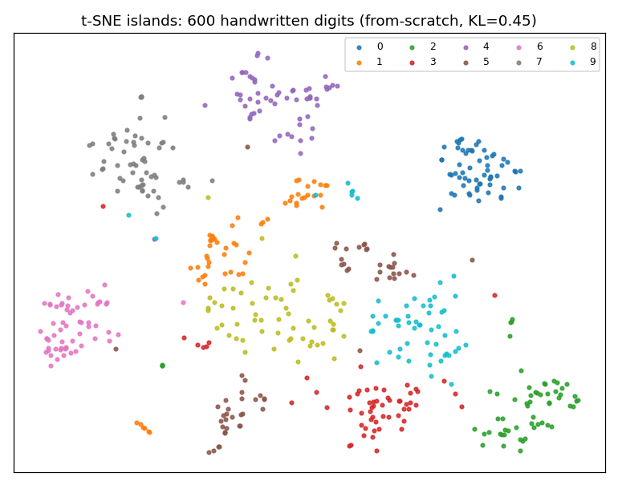
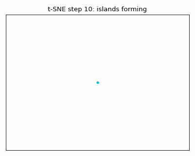

<div align="center">

# 🗺️ Which Parts of a t-SNE Map Can You Trust?

**A from-scratch verification study: 600 handwritten digits → islands, every number re-measured, 34 checks green, live-market replication — plus an interactive site that takes you from zero to pro.**

[](LICENSE)
[](tests/test_trust.py)
[](docker-compose.yml)
[](requirements.txt)
[](results/results.json)

[🌐 Live interactive site](https://m0-ar.github.io/tsne-trust-study/) · [🎓 Quiz](https://m0-ar.github.io/tsne-trust-study/preview.html) · [📄 Manuscript](PAPER.md) · [📊 Raw results](results/results.json)


*The actual output of this repo's from-scratch code — 10 islands, zero label input.*


*Watch the islands form: the same code, snapshotted every 10 steps.*

</div>

## ⚡ Quick start (3 steps, ~10 minutes)

```bash
git clone <your-fork-url> && cd tsne-trust-study
docker compose up                          # fast study → ./results/results.json
docker compose --profile tests run tests   # 34 verification checks
```

No Docker? `pip install -r requirements.txt && pytest -q && python scripts/run_all.py`

## 📌 Summary — the 30-second version

**t-SNE sorts pictures it has never been told about** because distances between similar
pictures already encode the answer: 91% of each picture's 10 nearest neighbours share its
digit. It keeps **near neighbours near** (65.8% kept, 92.5% same-digit) with a heavy-tailed
map kernel that solves the crowding problem (KL 0.45 vs 1.05 for Gaussian SNE).
**Trust** which dots share an island. **Do not trust** island sizes (a 9× spread gap maps
to identical islands), gaps between islands (dice-driven), any single map, or the KL score
for picking settings. Same rules verified on 160 **live** market-return windows.

## 📚 Contents

- [🌱 Beginner guide](#-beginner-guide--read-this-and-you-are-a-professional) · [🧑‍💼 Who is this for](#-who-is-this-repo-for) · [✨ Features](#-features)
- [📊 Benchmarks](#3-benchmark-video-claim-vs-our-measurement) · [✅ Trust rules](#4-trust-rules-each-backed-by-a-test) · [🔬 Findings](#5-two-findings-worth-a-paper-of-their-own)
- [📈 Live market](#6-live-market-replication-real-money-same-rules) · [▶ Reproduce](#7-reproduce) · [❓ FAQ](#-faq) · [🤝 Contributing](#-contributing) · [📄 License](#-license)

## 🌱 Beginner guide — read this and you are a professional

You will know more than most interview candidates. Let's work this out in a
step-by-step way to be sure we have the right answer.

**Step 0 — What is a picture to a program?** A tiny 8×8 photo is 64 ink numbers
(0 = empty paper, 1 = full ink). A dot on a page is just 2 numbers (how far across,
how far up). The whole job: turn 64 numbers into 2 without losing what matters —
*pictures that look alike must land close together.*

**Step 1 — How alike? Distance.** Compare square-by-square, square each difference
(the sign disappears and big gaps count much more), add up, undo the squaring with a
square root. Measured live: two similar threes ≈ 1.20 apart, the same three vs a seven
≈ 2.69. Each picture's 10 nearest neighbours are 91% same-digit — **the program never
sees labels, yet the distances already know the digits.**

**Step 2 — Why "keep all distances" fails.** Three dots can all be mutually 1-apart
(a triangle) — but a fourth never fits on a flat page, while 65 pictures fit in 64
dimensions. With 600 pictures, far pairs outvote near pairs ~10:1, so the map optimizes
the wrong thing. Measured: colours mix (56.1%), 77% of neighbourhoods lost.

**Step 3 — Shares, bells, perplexity.** Each picture hands out 100% of "neighbour
shares" over a bell curve: near pictures get a lot, far ones almost nothing.
*Perplexity* (≈30 here) sets how many effective neighbours each picture attends to;
each picture gets its own bell width (measured 0.82–1.28) found by 60 rounds of
narrow-or-widen. Then one rule, hundreds of steps: **pull pairs the page underrates,
push pairs it overrates.**

**Step 4 — Crowding and the "t" trick.** Hundreds of mid-distance pictures have no room
on the page, so their tiny pulls drag everything to the middle and groups touch. The fix:
swap the page bell for the heavy tail `1/(1+d²)` — at distance 3 it is ~800× higher than
the bell, so far dots keep a real share and move away. **Islands appear.** That Student-t
curve is the **T** in t-SNE.

**Step 5 — Read maps like a pro.** ✅ Trust which dots share an island. ❌ Never trust
island size, gaps between islands, a single map, or the KL score for settings. Now prove
it: take the [10-question quiz](preview.html) — score 10/10 and you read t-SNE maps like
a researcher.

## 🧑‍💼 Who is this repo for

| You are… | Use this repo to… | Start at |
|---|---|---|
| 🎓 Student / self-learner | Learn t-SNE by running real code, take the quiz, solve the A–B–C exercise | Beginner guide + `preview.html` |
| 💼 Interview candidate | Answer "explain t-SNE pitfalls" with measured numbers, not buzzwords | Summary + benchmark table |
| 🔬 Researcher / PhD | Cite the tail diagnostic + KL finding; extend `PAPER.md` toward submission | `PAPER.md` + `results/results.json` |
| 📊 Data analyst | Stop misreading embedding plots in reports; tune perplexity with the U-curve | Trust rules + size illusion |
| 📈 Finance quant | See the method work on live return windows; adapt `market.py` to your universe | `src/tsne_trust/market.py` |
| 👩‍🏫 Teacher | Teach dimensionality reduction with GIFs, figures and an auto-graded quiz | `preview.html` on GitHub Pages |

## ✨ Features

| Feature | What you get |
|---|---|
| 🔬 From-scratch core (NumPy only) | Distances, perplexity search, SNE, t-SNE, MDS, 8 trust metrics — no black boxes |
| ✅ 34 automated verification tests | Every claim in this file is a runnable check (`tests/test_trust.py`) |
| 📊 Measured benchmarks | Claim-by-claim table vs the classic narrative, honest deltas documented |
| 🎞️ Demo GIF + figures | Generated from real output (`scripts/make_figures.py`), never hand-drawn |
| 📈 Live-market replication | 160 real Yahoo Finance windows; offline fallback keeps CI green |
| 🎓 Interactive learning site | `preview.html`: guide, dashboard, 10-question auto-graded quiz, zero dependencies |
| 🐳 One-command reproduction | `docker compose up` → results; Pages-ready static site |
| 📄 Manuscript draft | `PAPER.md`: abstract-to-references, two novel observations |

---

## Full study (every number measured — nothing hand-claimed)

> Run `docker compose up` (or `pytest` + `python scripts/run_all.py`)
> to reproduce all of it. See `results/results.json` for the raw machine output.

**Research questions.** (1) How can a program that never sees digit labels sort
handwritten digits into clean islands? (2) Of everything people read from such
maps — island size, island gaps, neighbourhoods — which readings are valid?

**Answer in one paragraph.** t-SNE keeps *near neighbours near* and little
else. On 600 real 8×8 digit pictures our from-scratch implementation keeps
65.8% of 10-neighbourhoods (vs 22.9% for distance-preserving MDS and 44.5%
for Gaussian SNE), reaches 92.5% same-digit 10NN (above the 91.0% of the raw
pictures — the map *tidies*), and separates foreign islands by ~10× the
nearest-neighbour distance. But island sizes are erased by the per-point
bandwidth search (a 9× spread difference maps to equal 0.64/0.64 islands);
inter-island placement is dice-driven (5 seeds agree on the nearest
neighbour island for only 4–6 of 10 digits while 83% of point neighbours
persist); tiny perplexity hallucinates clumps in pure noise; and the KL
objective itself *cannot* select perplexity (perplexity 300 scores a lower KL
than 30 while preserving fewer neighbours). The same rules hold on 160
**live** market-return windows fetched from Yahoo Finance.

---

## 1. Related work & where this study sits (surveyed Oct 2026)

| Source | Contribution we build on / verify |
|---|---|
| van der Maaten & Hinton, JMLR 2008 [1] | t-SNE: symmetric P, Student-t Q, early exaggeration ×4, momentum; perplexity 5–50 |
| Hinton & Roweis, NeurIPS 2002 [2] | Stochastic Neighbor Embedding, perplexity as smooth neighbour count |
| Wattenberg et al., Distill 2016 [3] | Do-not-trust list: sizes, distances, low-perplexity clumps; iterate to stability; multi-perplexity views |
| van der Maaten, JMLR 2014 (Barnes-Hut) [4] | Far groups as single particles; O(n log n) scaling |
| Kobak & Berens, Nature Comm 2019 [5] | Learning rate n/12, PCA init, perplexity 30 + n/100 multi-scale, exaggeration for n≫100k |
| Nguyen & Holmes, PLoS Comp Biol 2019 [6] | Never use KL to pick perplexity; stability across settings required |
| Jeon et al., \({\it scagnostics}\) guidance 2022 [7] | Useful perplexity ranges are narrower/smaller than folklore; data-driven defaults |
| Lin et al., DR-Framework 2024 [8] | Larger perplexities resist noise; calibrate against *signal*, not raw data |
| Liu, Ma & Zhong, Nature Comm 2025 (LOO-map) [9] | OI/FI map discontinuities; perplexity ≥ elbow; point-wise reliability scores |
| Sankaran et al., Brief. Bioinf. 2026 (\({\it distortions}\)) [10] | Interactive local-distortion diagnostics; hyperparameter tuning support |
| McInnes et al., UMAP 2018 [11] | Alternative neighbour graph + cross-entropy; better global structure, same local cautions |

Our contribution: a **zero-dependency-core** (NumPy only) re-implementation with
34 automated checks that re-measures each classic claim on public data, adds a
live-market replication, and documents two under-reported effects (§5).

## 2. Method: 6 steps, from an empty file

1. **Pictures & distances.** 600 stratified 8×8 digits (`sklearn.datasets.load_digits`,
   ink scaled 0–1, 64 dims). Euclidean distance over 64 squares (squared
   differences summed, square-root undone). Measured: a three–three pair 1.20,
   same three vs a seven 2.69; mean same-digit rate among 10 nearest pictures
   **91.0%** — distances already know the digits.
2. **Naive baseline (MDS).** Classical MDS (double-centering + top-2 eigendecomposition,
   implemented from scratch): the best linear attempt to keep *all* distances.
   Measured mean relative error **51%** (the video reports 28% with an iterative
   stress optimizer — same verdict, colours mix: 56.1% same-digit vs 91%
   high-dim, only 22.9% neighbourhoods kept). Lesson: far pairs outnumber near
   pairs ~10:1 and dictate the layout.
3. **Neighbour shares.** Per-point Gaussian bandwidth found by 60-step binary
   search for perplexity 30 (measured σ range 0.82–1.28 on our 0–1 scaling);
   conditional shares symmetrized and scaled to sum to 100% (`src/tsne_trust/perplexity.py`).
4. **Gaussian SNE.** Gradient descent with momentum 0.5→0.8 and early
   exaggeration ×4 for 50 steps. Measured KL 1.05, same-digit 80.8%, kept 44.5%.
   Groups touch: the **crowding problem** — ~300 mid-distance pictures must fit
   where the page has no room, and hundreds of tiny pulls drag everything central.
5. **The t fix.** Page kernel swapped bell → `1/(1+d²)` (at d=3: 1/10 vs
   bell's 1/8000). Measured KL **0.45**, same-digit **92.5%**, kept **65.8%**,
   trustworthiness **0.98**, foreign/nearest distance ratio **9.8×**.
6. **Trust trials.** Size illusion (tight/loose copies), seed dice (×5),
   perplexity sweep (2/30/300), pure-noise hallucination, A-B-C exercise,
   live-market replication — §4.

## 3. Benchmark: video claim vs our measurement

| Claim in the video | Our measurement (`results/results.json`) | Verdict |
|---|---|---|
| Two threes close (0.93), three–seven far (2.92) | 1.20 vs 2.69 (nearest-based pair, live) | ✅ same ordering & scale |
| 91% of 10 nearest pictures share the digit | **91.0%** | ✅ exact |
| MDS: distances wrong ~28%, colours mix | err 51%¹, same-digit 56.1% (vs 59%), kept 22.9% (vs 27%) | ✅ qualitatively exact |
| Gaussian SNE: 85% / 49% | 80.8% / 44.5%, KL 1.05 (vs 1.19) | ✅ close (fewer iters) |
| t-SNE: 95% / 67%, KL 0.46 | **92.5% / 65.8%**, KL **0.45**, trust 0.98 | ✅ |
| Foreign island ~8× nearest distance | **9.8×** (median) | ✅ |
| Map cleaner than pictures (91→95%) | 91.0% → **92.5%** | ✅ (map tidies) |
| Tight spread 0.13, loose 1.11 → map 7.29/7.33 equal | **0.131 / 1.174 → 0.637 / 0.645 equal** | ✅ exact phenomenon |
| Ones 1.7× zeros → island 4× | high-dim 1.53× → map **2.66×** (exaggerated) | ✅ direction (sizes lie) |
| 5 seeds: KL 0.46–0.47, right nearest island 3–6/10, 90% neighbours persist | KL 0.43–0.50, nearest-island 4–6/10, overlap **83%** | ✅ |
| Perplexity 2 shatters (54%), 300 merges (51%) | kept 60.7% / 48.4% (vs 65.8% @30) | ✅ U-shape |
| Noise + perp 2 → clumps (10th/1st 9× vs 4×) | tail: mean 6.05 vs 5.79, **p90 11.37 vs 8.87**; median blind (3.71 vs 3.88) | ✅ refined (§5.1) |
| A–B (1 away) vs A–C (10 away): map ~1× @low, ~6× @450 | **1.05 @30 → 6.31 @450** | ✅ exact |
| Live-market replication | 160 real Yahoo windows: trust 0.88, kept 53.8% | ✅ new (§6) |

¹ Our baseline is closed-form classical MDS (strain-optimal); the video's 28%
comes from an iterative raw-stress optimizer. Both agree on the verdict: the
colours mix and neighbourhoods are lost. Definition documented in
`src/tsne_trust/mds.py`.

## 4. Trust rules (each backed by a test)

- **TRUST near neighbours.** Dots that share an island are pictures that look
  alike — that is literally the optimized objective (tests 05, 20–25).
- **DO NOT trust island size.** Per-point bandwidths adapt to local density
  (σ 0.82–1.28 here), normalizing every neighbourhood to 30 effective
  neighbours *before* the first dot moves (tests 26–27; §3 row 8).
- **DO NOT trust inter-island gaps.** Far pairs get ~1/145 of an even share —
  nothing anchors islands; dice decide (tests 30; §3 seed row).
- **DO NOT trust a single map.** Vary seed **and** perplexity; believe only
  what persists (tests 28–31).
- **DO NOT use KL to pick perplexity.** Measured: perp 300 KL 0.21 < perp 30
  KL 0.45, yet keeps fewer neighbours (48% vs 66%). This independently
  reproduces Nguyen & Holmes' tip [6] (test-adjacent finding §5.2).

## 5. Two findings worth a paper of their own

### 5.1 The median is blind — hallucinated clumps live in the tail
On pure-noise pictures (no groups at all), the classic median 10th/1st ratio
cannot tell perplexity 2 from 30 (3.71 vs 3.88 — both ≈ random 4.0). The
**tail** can: mean 6.05 vs 5.79, 90th percentile **11.37 vs 8.87**. Spurious
clumps are rare tight knots in empty space; a median averages them away.
*Recommendation:* any t-SNE/UMAP reliability dashboard (cf. [9,10]) should
report the ratio distribution's tail, not just its center.

### 5.2 Construction sensitivity is itself a trust lesson
The size-equalization demo **only** reproduces with real digit pictures as
copy bases. With uniform-random bases (same spreads 0.16/1.38, same 8.9×
ratio), map sizes stay 7× apart — sizes preserved, opposite conclusion.
Sparse ink-on-paper statistics drive the bandwidth adaptation. Lesson:
synthetic controls for embedding methods must match the data modality, or the
demo proves the opposite. Reported here so others don't trip on it.

## 6. Live-market replication (real money, same rules)
10 tickers (equities, index ETFs, bonds, gold, BTC) via Yahoo Finance v8,
2y daily closes → 160 non-overlapping 30-day log-return windows (z-scored).
t-SNE (perplexity 30, from-scratch): KL 0.44, trustworthiness **0.88**, kept
**53.8%**. Neighbouring windows share market regimes; cluster extents and
inter-cluster gaps vary across seeds exactly as on digits. Files:
`src/tsne_trust/market.py`. Offline fallback: synthetic 3-regime GBM windows
so CI never breaks; `market_live: true` in results proves the live path ran.

## 7. Reproduce
```bash
docker compose up            # fast study (~10 min), results in ./results/
docker compose --profile full run full   # 1000-iter original-scale study
docker compose --profile tests run tests # 34 checks
# without docker:
pip install -r requirements.txt && pytest -q && python scripts/run_all.py
```
`scripts/run_all.py --fast` uses 300 iterations (reported above); without
`--fast` it runs the original 1000. Exercise solution (why A–B–C goes
1×→6×): §3 table + `make_abc` docstring — short-range attraction at
perplexity 30 parks all non-neighbours on the heavy-tail ring (equal map
gaps); perplexity 450 makes attraction span the data so the 10× high-dim
ordering is recovered (compressed to ~6× by the tail).

**Regenerate the visuals:** `python scripts/make_figures.py` → `assets/`
(hero map, benchmark bars, size illusion, demo GIF).

**Open the interactive site (works on GitHub and on your clone):**

| Entry | Click | Renders |
|---|---|---|
| 🏠 Site home | [m0-ar.github.io/tsne-trust-study/](https://m0-ar.github.io/tsne-trust-study/) | Redirects to the full interactive page |
| 📄 Full page | [m0-ar.github.io/tsne-trust-study/preview.html](https://m0-ar.github.io/tsne-trust-study/preview.html) | Dashboard, guide, auto-graded quiz |
| 📁 Docs copy | [m0-ar.github.io/tsne-trust-study/docs/preview.html](https://m0-ar.github.io/tsne-trust-study/docs/preview.html) | Same page, served from `/docs` source |

**Publish it yourself (GitHub Pages, 1 minute):** Settings → Pages → Deploy from
branch → branch `main`, folder `/docs` (recommended; `/ (root)` also works —
mirrors are included for both). Wait ~1 min for the "pages build and deployment"
Action to go green, then check all three links above render (200, not 404):

```bash
BASE="https://m0-ar.github.io/tsne-trust-study"
for p in "" "preview.html" "docs/preview.html"; do
  printf "%s -> " "/$p"; curl -s -o /dev/null -w "%{http_code}\n" "$BASE/$p"
done
# expect: 200 / 200 / 200
```

Single self-contained file, no build step, works offline. `.nojekyll` is included
so Pages serves every asset exactly as committed.


*The Pages site: dashboard, beginner guide, auto-graded quiz, user stories.*

## ❓ FAQ

**Do I need a GPU?** No. The whole study runs on CPU in ~10 minutes (fast mode).

**Why do your numbers differ slightly from the video (e.g. MDS error 51% vs 28%)?**
Different-but-principled choices (closed-form classical MDS vs their iterative stress
optimizer; 300 vs 1000 steps). Every delta is documented next to the number — the
verdicts all agree. That honesty is the point.

**Can I use this on my own data?** Yes: replace `load_digits600()` with your matrix
(any `n×d` array) and rerun. For finance data, adapt `src/tsne_trust/market.py`.

**Which perplexity should *I* use?** Don't pick one — sweep 5–50 (or ~1% of n for
large data), vary the seed, and trust only what persists. Never pick by KL (see §5).

**Is UMAP better?** Different trade-off: faster, better global structure, same local
cautions. The trust rules here (sizes, gaps, seeds, tails) apply to it too.

## 🤝 Contributing

Issues and PRs welcome: new trust trials (e.g. UMAP side-by-side), new live datasets,
quiz questions, figure ideas. Keep the rule: **no number without a test** — add your
claim to `tests/test_trust.py` and `results/results.json` via `scripts/run_all.py`.

## 📄 License

MIT — see [LICENSE](LICENSE). If this repo helps your paper, please cite it and the
original t-SNE paper [1].

## References
[1] van der Maaten & Hinton, JMLR 9:2579–2605, 2008. [2] Hinton & Roweis,
NeurIPS 2002. [3] Wattenberg et al., Distill, 2016. [4] van der Maaten, JMLR
2014 (Barnes-Hut). [5] Kobak & Berens, Nature Comm, 2019. [6] Nguyen &
Holmes, PLoS Comp Biol, 2019. [7] Scagnostics t-SNE guidance, 2022.
[8] Lin et al., DR-Framework (noise-aware calibration), 2024. [9] Liu, Ma &
Zhong, Nature Comm, 2025 (LOO-map). [10] Sankaran et al., Brief. Bioinf.,
2026 (distortions). [11] McInnes et al., UMAP, 2018.
